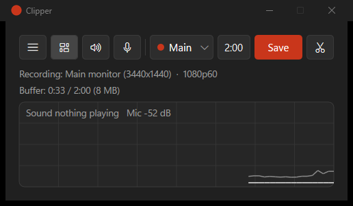

# Clipper

A tiny always-on replay buffer for Windows. It quietly keeps the last couple of
minutes of your screen or game, and one key press saves them as an `.mp4`. Think
"OBS replay buffer" without OBS: a ~550 KB native app, about 60 MB of RAM while
recording.

